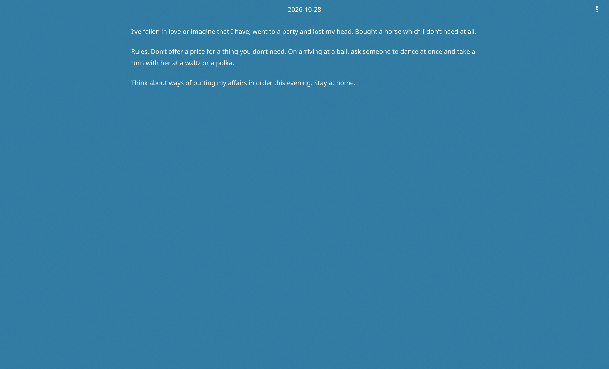

# bluepage

A minimal, personal, and bluish journal application made with [Tauri](https://tauri.app), [Vite](https://vite.dev) and [React](https://react.dev).



## Installation

Every published release is built by GitHub Actions for all three desktop platforms and attached to the release.

- macOS: Apple Silicon (`aarch64`) and Intel (`x86_64`)
- Linux
- Windows

## Data

Everything is local. Entries are kept in a SQLite database saving the content as markdown as well as a copy in plain text for a future search functionality.

## Project structure

```text
src/                  React frontend
  components/         toolbar, editor, date picker, settings, notifications
  hooks/              entry loading and autosave lifecycle
  lib/                db wrappers (the only IPC), markdown, autosave, settings
  stores/             zustand: current date, status notices
  styles/             CSS and design tokens
src-tauri/            Rust backend
  src/                commands, SQLite pool, models
  migrations/         append-only SQL
public/               standalone splash screen
```

## License

MIT — see [LICENSE](LICENSE).
